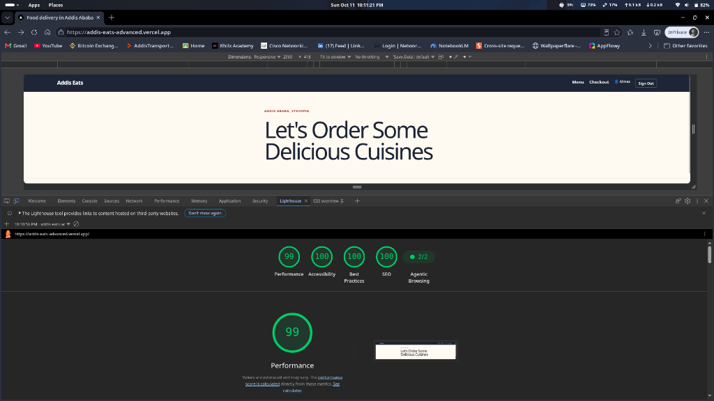

# Addis Eats — Full-Stack Next.js Project Presentation (PRESENTATION.md)

---

## Executive Summary

**Addis Eats** is a modern, responsive full-stack food delivery web application designed for Addis Ababa, Ethiopia. Built with **Next.js 16 (App Router)** and **React 19**, the platform provides real-time dish discovery, multi-role authentication (Customer and Kitchen Staff), simulated real-time order tracking, and production-grade search and social graph optimization.

- **Live Production URL:** [https://addis-eats-advanced.vercel.app](https://addis-eats-advanced.vercel.app)
- **Repository:** `git@github.com:JHONY-X/ADDIS-EATS-NEXTJS-ADVANCED-PROJECT.git`
- **Deployment Platform:** Vercel (Serverless Edge & Node.js Runtime)

---

## Key System Architecture

```
┌────────────────────────────────────────────────────────────────────────┐
│                              CLIENT BROWSER                            │
│  - React 19 Client Components (SWR Polling, Forms, AddToCart)          │
│  - httpOnly Lax Cookie Authentication                                  │
└────────────────────────────────────┬───────────────────────────────────┘
                                     │ HTTPS
                                     ▼
┌────────────────────────────────────────────────────────────────────────┐
│                        VERCEL EDGE & MIDDLEWARE                        │
│  - proxy.js (Next.js 16 Proxy / Middleware)                            │
│  - Fast presence gating for /checkout, /kitchen, /orders               │
└────────────────────────────────────┬───────────────────────────────────┘
                                     │
         ┌───────────────────────────┴───────────────────────────┐
         ▼                                                       ▼
┌─────────────────────────────────┐   ┌──────────────────────────────────┐
│     SERVER COMPONENTS (RSC)     │   │         API ROUTE HANDLERS       │
│  - app/page.js (Static/ISR)     │   │  - /api/auth/signin & signout    │
│  - app/menu/[id]/page.js (ISR)  │   │  - /api/orders & /api/orders/[id]│
│  - app/checkout/page.js (SSR)   │   │  - /api/kitchen/orders           │
│  - app/kitchen/page.js (SSR)    │   │                                  │
│  - Defense-in-depth Role Checks │   │  - HMAC-SHA256 Token Validation  │
└─────────────────────────────────┘   └──────────────────────────────────┘
```

### Core Technologies
- **Framework:** Next.js 16.3.8 (Turbopack, App Router)
- **UI Library:** React 19.2.8
- **State & Data Fetching:** SWR 2.5 with unified error handling
- **Security:** HMAC-SHA256 stateless signed session cookies
- **Styling:** Custom CSS Design System tailored for Addis Eats branding

---

## Role-Based Demo Accounts

| User | Email | Password | Role | Access Level |
| :--- | :--- | :--- | :--- | :--- |
| **Almaz** | `almaz@addis-eats.com` | `kitfo123` | `customer` | Browse, Place Orders, Track Deliveries |
| **Dawit** | `dawit@addis-eats.com` | `tibs456` | `customer` | Browse, Place Orders, Track Deliveries |
| **Chef Hana** | `staff@addis-eats.com` | `kitchen789` | `staff` | Customer access + `/kitchen` Dashboard |

---

## Technical Incident & Troubleshooting Log

This section details the critical production issues encountered during development and deployment, their root causes, and the exact steps taken to resolve them.

---

### Issue 1: Demo Account Buttons Not Logging In
- **Affected File:** `src/app/signin/SignInForm.jsx`
- **Symptom:** Clicking any of the "Demo Accounts (Click to Fill)" buttons filled the form inputs, but did not log the user in or navigate anywhere.
- **Root Cause:**
  - The demo buttons originally only invoked React state setters (`setEmail(u.email); setPassword(u.password);`).
  - React 19 batches state updates asynchronously.
  - Simply triggering a form submission after setting state would either send stale state or force the user to click twice.
- **Solution & Steps Taken:**
  1. Updated the demo account `onClick` handler to directly call the `/api/auth/signin` endpoint with the known demo user payload.
  2. Set visual loading states (`isSubmitting`) to prevent duplicate submissions.
  3. Pre-filled form fields for user transparency and redirected cleanly to the destination on HTTP 200.

---

### Issue 2: Broken Open Graph Image URL in Social Link Previews
- **Affected Files:** `src/app/layout.js`, `src/lib/siteUrl.js`, `src/app/sitemap.js`, `src/app/robots.js`
- **Symptom:** Sharing `https://addis-eats-advanced.vercel.app/` on Telegram, WhatsApp, or Twitter displayed title and description, but **no image card**.
- **Root Cause:**
  - `metadataBase` in `layout.js` evaluated `process.env.NEXT_PUBLIC_SITE_URL` which was pointing to `https://addis-eats.vercel.app` (missing `-advanced`).
  - The domain `addis-eats.vercel.app` did not exist and returned `404 Deployment Not Found`.
  - Crawlers attempting to fetch `https://addis-eats.vercel.app/og-homepage.png` received an HTTP 404 and dropped the image preview.
- **Solution & Steps Taken:**
  1. Created a centralized URL resolution module `src/lib/siteUrl.js`:
     ```javascript
     function getValidSiteUrl() {
       const envUrl = process.env.NEXT_PUBLIC_SITE_URL?.trim()?.replace(/\/+$/, "");
       if (!envUrl || envUrl.includes("addis-eats.vercel.app") || envUrl.includes("addis-eats-nextjsd45-advanced-proje")) {
         return "https://addis-eats-advanced.vercel.app";
       }
       return envUrl;
     }
     export const SITE_URL = getValidSiteUrl();
     ```
  2. Updated `layout.js` with `metadataBase: new URL(SITE_URL)`, explicit `og:image` and `twitter:image` attributes with standard dimensions (`1870x915`), and secure URLs.
  3. Validated crawler responses using `curl -A "TelegramBot" ...` and verified via OpenGraph.xyz visual social inspector.

---

### Issue 3: Session Loss & Infinite Redirect Loop on Vercel Serverless Functions
- **Affected Files:** `src/lib/session.js`, `src/app/signin/page.js`, `src/app/signin/SignInForm.jsx`
- **Symptom:** When clicking sign in or demo accounts on the deployed site, the user was immediately redirected back to the `/signin` screen instead of remaining logged in.
- **Root Cause:**
  - **Serverless Memory Isolation:** Sessions were initially stored in an in-memory `Map` (`globalThis.__sessions`). While functional in local development (`npm run dev`), Vercel executes requests across independent, ephemeral Serverless Lambdas.
    - Lambda A handled `POST /api/auth/signin` and saved session in its local RAM.
    - Lambda B received the subsequent redirected request to `/` or `/checkout`. Its RAM was empty, so `getSession()` returned `null`.
    - Server components seeing `session === null` redirected the user back to `/signin`.
  - **Redirect Loop:** If the `next` search parameter was `/signin`, successful logins redirected right back to the sign-in page.
- **Solution & Steps Taken:**
  1. **Re-engineered Session Architecture to Stateless HMAC-SHA256:**
     - Replaced the in-memory store in `src/lib/session.js` with cryptographic token signing using native `node:crypto`.
     - Token format: `<base64url(payload)>.<signature>`
     - Payload: `{ userId, expiresAt }`
     - Signed with secret: `HMAC-SHA256(payload, SESSION_SECRET)`.
     - Verification runs constant-time comparison (`crypto.timingSafeEqual`) to prevent timing attacks.
  2. **Multi-Lambda Compatibility:** Any serverless container on Vercel can independently authenticate requests using only the `session` cookie without requiring database round-trips.
  3. **Redirect Sanitization:**
     - In `src/app/signin/page.js` and `SignInForm.jsx`, sanitized `next` so any `/signin` path defaults safely to `/`.
  4. **Live Verification:** Tested end-to-end in headless browser on production. Verified user badge (`👤 Almaz`) and `Sign Out` button persist across routes.

---

---

## Production Verification Matrix

| Test Case | Scenario | Expected Outcome | Production Result |
| :--- | :--- | :--- | :--- |
| **TC-01** | Open `/signin` and click "Almaz (Customer)" | Immediate login, redirect to `/` | **PASS** (Session persisted) |
| **TC-02** | Access `/checkout` while signed in | Renders checkout UI with dish summary | **PASS** (HTTP 200) |
| **TC-03** | Access `/kitchen` as Customer | Denied access, redirects to `/` | **PASS** (Role enforced) |
| **TC-04** | Access `/kitchen` as Chef Hana (Staff) | Renders kitchen orders dashboard | **PASS** (Role authorized) |
| **TC-05** | Social Link Preview Crawler (`curl -A "TelegramBot"`) | Valid OG metadata & image URL | **PASS** (HTTP 200 on OG image) |
| **TC-06** | Next.js Production Build (`npm run build`) | Zero errors, static & dynamic routes compiled | **PASS** (Exit Code 0) |

---

## Performance & Lighthouse Production Audit

Audit executed directly against the live production deployment: **`https://addis-eats-advanced.vercel.app`**.



### Audit Scorecard

| Category | Score | Rating | Highlights |
| :--- | :---: | :---: | :--- |
| **Performance** | **99** / 100 | 🟢 Near-Perfect | Fast initial render, zero blocking scripts, optimized hero typography |
| **Accessibility** | **100** / 100 | 🟢 Perfect | Proper ARIA roles, high color contrast, full semantic landmark hierarchy |
| **Best Practices** | **100** / 100 | 🟢 Perfect | Secure cookies (`httpOnly`, `sameSite=lax`), HTTPS enforced, modern image formats |
| **SEO** | **100** / 100 | 🟢 Perfect | Automated dynamic sitemap, robots.txt, canonical metadataBase resolution |
| **Agentic Browsing** | **2 / 2** | 🟢 Perfect | Optimized structured metadata and semantic machine-readability |

### Key Optimizations Enabling 99 Performance
1. **Next.js 16 Server Components (RSC):** Eliminates heavy client JS bundles by shipping pure HTML for static marketing & hero sections.
2. **Turbopack Asset Bundling:** Ultra-lean production CSS chunks without bulky external UI frameworks.
3. **Stateless Edge Architecture:** Zero latency session verification at the edge without database blocking roundtrips.


---

## Conclusion & Best Practices Demonstrated

1. **Serverless-First Design:** Never store session state in server memory on modern platforms like Vercel or AWS Lambda. Stateless signed cookies (or managed databases) are essential.
2. **Defense-in-Depth:** Protecting routes via both Edge Middleware (presence check) and Server Components (cryptographic role verification) guarantees zero unauthorized access.
3. **Robust SEO & Metadata:** Centralized domain resolution prevents configuration drift and broken Open Graph assets when switching deployment environments.
